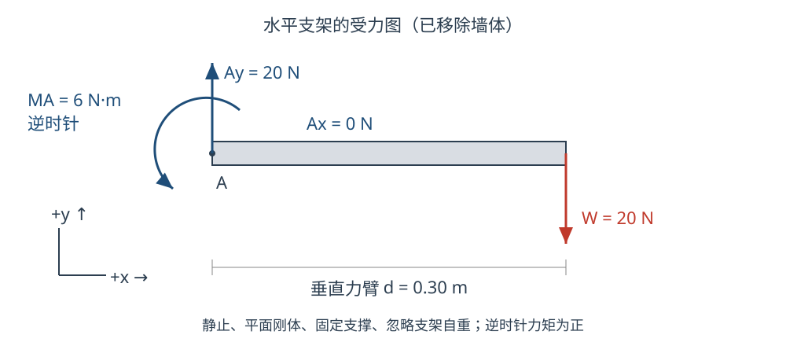

# 第 01 单元：静止水平支架的受力分析

目标：区分力与力矩，理解固定支撑的作用，能画简单受力图并检查平衡。

## 已知条件、假设与适用范围

对象：机器人上的水平相机支架，左端 A 固定，右端受到竖直向下 20 N 的力，作用位置距 A 为 0.30 m。

假设：支架静止、忽略支架自重、理想刚体、只研究图示平面，连接为理想固定支撑。向右为 x 正向、向上为 y 正向，逆时针力矩为正。

适用范围：求该理想模型中的支撑合力与反力矩。未检查材料强度、连接处螺栓、变形、振动、冲击或疲劳。

## 1. 力：谁在推或拉谁

力是物体之间的相互作用，可以改变运动状态或使物体变形。描述力要明确大小、方向、作用位置，以及谁作用于谁。

本例中，相机对支架施加 20 N 的竖直向下作用力，作用于支架右端。N 是牛顿，质量单位 kg 不能直接代替力的单位。

重力大小：`W = m g`。m 的单位是 kg，g 的单位是 m/s²，W 的单位是 N。支架静止不等于没有受力。

## 2. 力矩：力的转动效果

水平托着杆时，同样的重物离手越远，就越难保持水平。力矩描述力绕指定点或轴的转动效果。

力矩大小：`M = F d⊥`。d⊥ 是参考点到力的作用线的垂直距离，单位 m，不是任何情况下都取杆长。力矩单位 N·m。

本例中杆水平、力竖直，力臂为 0.30 m。绕 A 点的外力矩大小为 `20 × 0.30 = 6 N·m`，方向顺时针。平面问题用顺时针/逆时针描述力矩方向，不说力矩“向下”。

## 3. 支撑反力与反力矩

固定端要同时托住载荷、阻止转动。机架对支架的作用等效为水平反力 Ax、竖直反力 Ay 和反力矩 MA。

- Ax = 0 N。
- Ay = 20 N，向上。
- MA = 6 N·m，逆时针。

允许自由转动的理想铰链不能照搬固定支撑模型。在平面模型中，理想铰支撑提供两个方向的反力，但不提供约束转动的反力矩。

相机压支架和支架托相机作用于不同物体，不能画在同一个支架受力图中互相抵消。

## 4. 受力图与平衡

1. 单独取出支架作为研究对象。
2. 移除相机，用向下的载荷箭头替代。
3. 移除机架，用 Ax、Ay、MA 替代。
4. 标明尺寸、坐标和方向。



静止时：

```text
ΣFx = Ax = 0
ΣFy = Ay - 20 = 0
ΣMA = MA - 20 × 0.30 = 0
```

“Σ”表示求和。三条方程分别检查水平、竖直和转动平衡。原本静止的刚体在这些平衡条件下保持静止；不能把“合力矩为零”泛化为“任何物体都不转动”。

## 练习

### 基础题

水平支架在 A 点固定，右端受到竖直向下 10 N 的力，距离 A 为 0.20 m。静止，忽略自重。

1. 这个力绕 A 点产生多大的力矩？方向是什么？
2. A 点需要提供多大的竖直反力和反力矩？注明方向。

### 工程应用题

2 kg 的相机安装在水平支架上，重心距固定端 A 的水平距离为 0.25 m。取 g = 10 m/s²，忽略支架自重，机器人静止。

1. 相机重力是多少 N？
2. 固定端需要承担多大的竖直反力和反力矩？注明方向。
3. 重心距离增加到 0.50 m，两个结果分别怎样变化？为什么？

题目中的 g 是教学近似；不把这里的载荷模型作为运动中机器人的完整设计工况。

## 本课作用与下一课

学会选择研究对象、识别外力、判断力臂和转动趋势、检查力与力矩平衡。这是机械臂关节载荷及安装支架分析的基础。

下一课：支架自重与重心。前置知识是 W = mg、M = Fd⊥、方向判断和静力平衡。尚未开展下一课。

## 计算验证

运行 [lesson-01.py](lesson-01.py) 核算示例和练习，合力与合力矩残差均为零；额外用 r×F 的平面分量核对示例力矩，并检查力臂加倍时反力矩加倍。

这里是理想模型的静力计算核算；不是有限元仿真、材料强度验证或实物验收。脚本当前没有使用 Pint，单位依据公式逐项检查。
