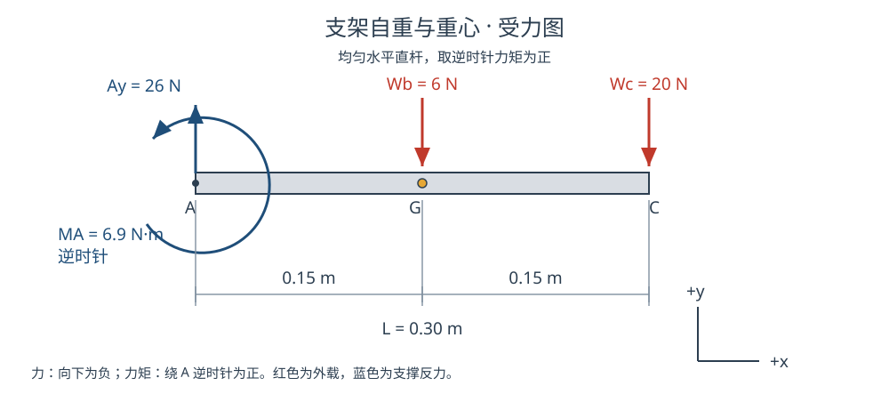

# 第 02 单元：支架自重与重心

状态：**已完成**（2026-11-16）。作答与概念解释反馈见 [第二课反馈](lesson-02-review.md)。作答记录见 [反馈](lesson-02-review.md)。

## 学习目标与前置知识

承接 [第一课](lesson-01.md) 的重力 `W=mg`、力矩 `M=Fd⊥` 和固定端平衡。学完应能区分质量（kg）、重力（N）、力矩（N·m），解释均匀杆重心在中点，计算含自重的支撑反力与反力矩，并正确标注方向。

## 1. 支架为什么会自己产生力矩？

工业机器人上的水平相机支架，即使没安装相机，支架自身也会受到向下的重力。只要重力的作用线与固定端 A 有水平距离，重力就会使支架产生顺时针转动趋势。

在本课近似**均匀重力场**中，刚体的重力可以等效集中作用在一个位置——**重心 G**；此时重心与质量中心重合。重心是位置，不是额外的一股力。

对**等截面且材料密度均匀**的直杆，左右两半关于中点对称，左右各小块质量在中点两侧的力矩相互抵消，所以 `x_G=L/2`。有缺口、凸台或质量偏置的真实支架，不能直接套用这一结论。

## 2. 工程对象、已知、假设与受力图

示例：左端 A 固定的水平相机支架，支架自身质量 `m_b=0.6 kg`，长度 `L=0.30 m`，末端相机质量 `m_c=2.0 kg`，其重心距 A 水平距离 `x_c=0.30 m`。教学近似 `g=10 m/s²`。

假设：支架均匀、足够刚、静止，连接为理想固定支撑；只看平面受力，忽略附件质量、弹性、加速度、振动和冲击。**研究对象仅为支架**，相机对它施加向下的力。

正方向：向右为 +x，向上为 +y，**逆时针力矩为正**。



受力图按仓库 [mechanics-visuals 规范](../resources/vendor/baratilab/skills/mechanics-visuals/references/fbd_style.md) 绘制：灰色表示支架，红色是两股向下的外载，蓝色是固定端反力；标明 G 和尺寸。

## 3. 示例计算：重量、重心、力臂

先把质量换成重力，再选 A 点计算力矩。由于本例杆水平、重力竖直，重力作用线到 A 的垂直距离就是对应水平位置。

```text
支架重心位置：x_G = L/2 = 0.15 m
支架自重：    W_b = m_b × g = 0.6 × 10 = 6 N（向下）
相机重量：    W_c = m_c × g = 2.0 × 10 = 20 N（向下）

支架自重力矩：M_b = 6 × 0.15 = 0.9 N·m（顺时针）
相机重力力矩：M_c = 20 × 0.30 = 6 N·m（顺时针）
```

不能把支架自重既作为分布载荷又作为集中力重复加入；用集中力 `W_b` 是在**本例静力平衡**中把分布重力等效到重心。

## 4. 固定端如何保持静止？

```text
ΣF_x = A_x = 0
ΣF_y = A_y - 6 - 20 = 0
       A_y = 26 N（向上）

ΣM_A = M_A - 6×0.15 - 20×0.30 = 0
       M_A = 6.9 N·m（逆时针）
```

第一课忽略自重时，`A_y=20 N`、`M_A=6 N·m`。加上支架自重后反力增加 6 N，反力矩增加 0.9 N·m，也就是多出 15%。**向下的是重力，不是力矩；力矩应该描述顺时针或逆时针。**

[示例计算脚本](lesson-02.py) 使用 Python 标准库，检查平衡残差、无自重极限，并用 1000 个微小杆段独立核对自重力矩。[验证记录](lesson-02-verification.md)。脚本**只计算上述公开示例，不包含练习答案**。

## 5. 与实际 CAD 支架的关系

你之前设计过含底板、凸台和孔的 `bracket_v2.py`。这种非均匀形状可能有偏心重心；真实质量和重心需要最终几何与材料密度数据，不能直接套用 `L/2`。多部分可用：

```text
m_i = ρ_i × V_i
x_G = (Σ m_i × x_i) / (Σ m_i)
```

其中密度 `ρ_i` 单位 kg/m³，体积 `V_i` 单位 m³，质量 `m_i` 单位 kg。孔是从实体中减去的体积。对 CAD 布尔后几何，应从最终实体求质量属性，避免重复计数。**本课没有读取或计算真实 bracket_v2 的质量属性**，也不能据此证明结构强度、刚度或装配可靠性。

## 6. 练习：请先自己作答

### 基础题：不带相机的均匀支架

水平直杆左端 A 固定，`L=0.40 m`、质量 `m=0.8 kg`，无其他载荷，`g=10 m/s²`，杆静止。

1. 求自重（N，方向）与重心距 A 的距离（m）；解释重心为何在这里。
2. 求 A 的竖直反力和反力矩，注明单位与方向，并写出 `ΣF_y`、`ΣM_A`。

### 工程应用题：相机并非安装在末端

均匀水平支架长 `0.40 m`、自身质量 `0.6 kg`，相机质量 `1.5 kg`，其重心距固定端 A 的**水平距离**为 `0.35 m`，`g=10 m/s²`。系统静止，忽略其他附件。

1. 求支架自重、相机重量和支架重心位置。
2. 求 A 的竖直反力与反力矩；**忽略支架自重会少算多少反力矩**？
3. 如果相机向 A 移动，使其位置变为 `x_c=0.20 m`，竖直反力、反力矩各如何变化？说明原因。

请列出公式、数值、单位和方向。练习现已作答，逐项反馈见 [作答记录](lesson-02-review.md)，参考结果见 [答案记录](lesson-02-answer-key.json)。

## 本课作用、边界与下一课

这为机械臂连杆自重、末端工具负载、固定端初步选型建立物理直觉。下一课「03 多载荷平衡」再推广到更多外力和位置。本课仅是**理想刚体的静力估算**；不涉及 CAD 几何验收、FEA、材料强度或实物验证。数值练习与力矩物理解释均已完成。下一课进入「03 多载荷平衡」。

## 资源来源

- [mechanics-visuals 固定版本](https://github.com/BaratiLab/mechanical-engineering-skills/blob/119b1a946e2ea43784f5d045057b59757a1a7dd1/skills/mechanics-visuals/SKILL.md)，已读 [FBD 图示规范](../resources/vendor/baratilab/skills/mechanics-visuals/references/fbd_style.md)。本图为原创 SVG，未调用上游绘图程序。
- [worked-problem-generator 固定版本](https://github.com/BaratiLab/mechanical-engineering-skills/blob/119b1a946e2ea43784f5d045057b59757a1a7dd1/skills/worked-problem-generator/SKILL.md)，已读 [习题模板](../resources/vendor/baratilab/skills/worked-problem-generator/references/problem_template.md)，据此编排情景、已知与问题，不提前公开题解。
