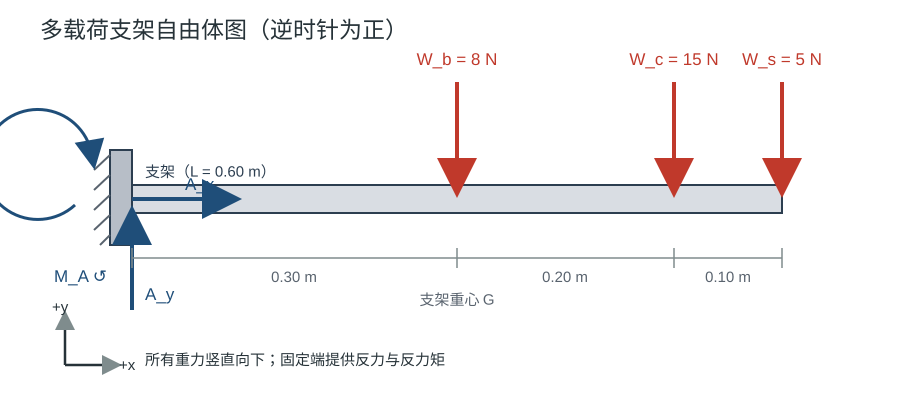

# 第 03 单元：多载荷平衡

状态：**讲解、示例与练习已发布；等待学习者作答**（2026-11-17）。不要提前公开练习答案。完成后记录原答与逐题反馈。

## 学习目标与前置知识

承接 [第一课：固定支撑受力分析](lesson-01.md) 与 [第二课：支架自重与重心](lesson-02.md)。学完应能：

1. 把一个结构上的多个载荷逐个列出来，不漏算、不重复计算。
2. 分别计算每个载荷对同一参考点的力矩，再按方向带符号相加。
3. 用 `ΣF_x=0`、`ΣF_y=0`、`ΣM=0` 检查二维刚体静力平衡。
4. 求出固定端反力，并能解释为什么移动某一个载荷会改变反力矩，却不一定改变竖直反力。

## 教学资源

本课实际读取了仓库内固定版本的：

- [mechanics-visuals/SKILL.md](../resources/vendor/baratilab/skills/mechanics-visuals/SKILL.md)：要求先明确几何、载荷、支撑和符号约定；受力图应隔离物体、区分外载与反力，并核对力和力矩平衡。
- [FBD 图示规范](../resources/vendor/baratilab/skills/mechanics-visuals/references/fbd_style.md)：固定端用 (A_x,A_y,M_A) 表示反力；外载与反力使用不同视觉标记；每个箭头标注作用位置。
- [worked-problem-generator/SKILL.md](../resources/vendor/baratilab/skills/worked-problem-generator/SKILL.md) 与 [习题模板](../resources/vendor/baratilab/skills/worked-problem-generator/references/problem_template.md)：先核算例题，再给出已知、求解目标、假设和分层练习。

本课的自由体图按上述规范绘制。FBD 脚本没有直接生成这张图；数值核算使用本课附带的 Python 标准库脚本。

## 1. 为什么多个载荷必须一起计算？

想象一根固定在墙上的相机支架：

- 支架本身有重量；
- 相机有重量；
- 相机旁边还有一个传感器；
- 以后还可能夹着工件。

每个重量都会向下拉支架。它们会共同造成两种效果：

- **向下的总力**：所有向下的重量加在一起；
- **绕固定端转动的趋势**：每个重量按自己的位置产生力矩，再把这些力矩相加。

这里有一个关键点：**力可以直接按方向相加；力矩必须连同各自的力臂一起计算，不能只把力加起来就随便乘一个距离。**

## 2. 先明确研究对象与模型

本课例题只研究灰色的支架本体。相机和传感器不画成独立刚体，而是把它们对支架的作用等效为各自位置处的向下重力。

已知：

- 水平支架左端 A 与墙体理想固定；
- 支架长度 (L=0.60,m)，质量 (m_b=0.8,kg)，假设均匀；
- 相机质量 (m_c=1.5,kg)，重心距 A 为 (0.50,m)；
- 传感器质量 (m_s=0.5,kg)，重心距 A 为 (0.60,m)；
- 取 (g=10,m/s^2)，结构静止。

假设与边界：

- 支架足够刚，处于静止状态，做二维平面静力分析；
- 支架均匀，因此支架重心在中点 (0.30,m)；
- 所有重力竖直向下，没有水平外载；
- 忽略线缆拉力、紧固件自重、弹性变形、振动、冲击和加速度；
- 固定端能够提供水平反力、竖直反力和反力矩。

这只是理想刚体静力估算，不是支架强度或安全性验收。

## 3. 受力图：先把所有力画全

约定：

- 向右为 (+x)，向上为 (+y)；
- 逆时针力矩为正，顺时针力矩为负；
- (A_x,A_y) 是固定端反力，(M_A) 是固定端反力矩；
- (W_b,W_c,W_s) 分别是支架、相机、传感器的重力。

**为什么 A 点有三个反力未知量？** 因为理想固定端既阻止水平移动，也阻止竖直移动，还阻止支架转动，所以要用 (A_x,A_y,M_A) 描述它的约束作用。这是第一课学过的固定支撑模型。

## 4. 把每个载荷变成力和力矩

先算重量：

[
W=mg
]

| 载荷 | 质量 | 重力 | 作用位置 |
|---|---:|---:|---:|
| 支架自重 | 0.8 kg | 8 N，向下 | 0.30 m |
| 相机 | 1.5 kg | 15 N，向下 | 0.50 m |
| 传感器 | 0.5 kg | 5 N，向下 | 0.60 m |

对于本题，支架水平、重力竖直，因此每个重力的垂直力臂就是它到 A 点的水平距离。

[
M=F\times d
]

逐个计算对 A 点的力矩：

| 载荷 | 计算 | 力矩方向 |
|---|---:|---|
| 支架自重 | (8\times0.30=2.4,N\cdot m) | 顺时针 |
| 相机 | (15\times0.50=7.5,N\cdot m) | 顺时针 |
| 传感器 | (5\times0.60=3.0,N\cdot m) | 顺时针 |

因此外载荷产生的顺时针力矩总和为 (2.4+7.5+3.0=12.9,N\cdot m)。

注意：**三个力的大小不能直接相加后，再分别乘三个不同的距离。** 必须逐个求力矩再求和；或者先求出整体重心，再把总重力等效作用在整体重心上。这两种算法结果相同，不能重复计算。

## 5. 写出三个平衡条件

静止的二维刚体必须同时满足：

- 水平方向不平移：(sum F_x=0)
- 竖直方向不平移：(sum F_y=0)
- 不绕平面内任何点转动：(sum M=0)

本题选择 A 点作为取矩点，并约定逆时针为正。

### 第一步：水平方向

没有水平外载，所以：

[
sum F_x=A_x=0
]

### 第二步：竖直方向

向上为正，三个重力向下：

[
sum F_y=A_y-8-15-5=0
]

所以固定端需要提供向上的竖直反力，大小等于三个向下重量之和。

### 第三步：绕 A 点的力矩

三个重力都使支架顺时针转动，因此它们在方程中为负；固定端反力矩必须逆时针：

[
sum M_A=M_A-8\times0.30-15\times0.50-5\times0.60=0
]

因此：

[
M_A=8\times0.30+15\times0.50+5\times0.60
]

[
M_A=12.9,N\cdot m
]

### 为什么选 A 点取矩？

(A_x) 和 (A_y) 的作用线都经过 A 点，对 A 的力臂为零，因此它们不会出现在绕 A 点的力矩方程里。这样就能先求出固定端需要抵抗的转动效果。

**取矩点可以选其他位置；静力平衡时，绕任意点的合力矩都为零。** 初学时优先选择未知反力通过的点，通常最省事。

## 6. 用整体重心再理解一次

这和第二课直接衔接。三个重力都在同一个均匀重力场中，因此可以把它们等效为一个总重力，作用在整体重心：

[
x_G=\frac{8\times0.30+15\times0.50+5\times0.60}{8+15+5}
]

[
x_G\approx0.4607,m
]

总重力为三个重量之和，作用在距 A 约 (0.4607,m) 的位置。用总重力乘这个位置，会得到与逐个求力矩相同的结果。

两种方法怎么选：

- **逐个求力矩**：更适合载荷多、位置不同、方向可能不同的结构，最不容易漏项。
- **整体重心法**：适合多个平行重力载荷，能帮助你理解系统整体的重心位置。

## 7. 例题核算与验证边界

本课附带 [Python 示例脚本](lesson-03.py)。本次已实际执行同样的数值核算，得到：

- 三个载荷分别产生 2.40、7.50、3.00 N·m 的顺时针力矩；
- 总向下重量为 28.0 N；
- 等效整体重心距 A 约 0.4607 m；
- 平衡方程残差为 0 N 和 0 N·m。

当前执行环境没有安装 Pint，因此本次使用 Python 数值计算，并人工核对 kg、N、m、N·m 的量纲；没有声称做过自动单位库检查。

验证边界：这是计算一致性核对，不是 CAD 几何检查、有限元分析（FEA）、结构强度验证或实物加载试验。真实支架还要考虑材料、截面、孔位、连接、挠度、冲击和安全系数。

## 8. 练习：请先自己作答

请像前两课一样，写出公式、代入过程、数值、单位和方向。暂时不要只报最终数字。

### 基础题：一根支架上有两个额外载荷

水平支架左端 A 固定，长度 (L=0.50,m)，支架质量 (m_b=0.6,kg)，假设均匀。另有两个竖直向下的载荷：

- 载荷 P1：(10,N)，作用位置距 A 为 (0.20,m)；
- 载荷 P2：(8,N)，作用位置距 A 为 (0.45,m)。

取 (g=10,m/s^2)，支架静止。

请回答：

1. 支架自身重量是多少？作用点在哪里？
2. P1、P2 和支架自重分别对 A 点产生多大的力矩？方向是什么？
3. 固定端 A 需要提供多大的竖直反力和反力矩？方向是什么？
4. 写出 (sum F_y=0) 与 (sum M_A=0) 检查平衡。

### 工程应用题：机械臂末端安装多个部件

假设一根水平机械臂连杆左端 A 固定，长度 (0.80,m)，自身质量 (1.2,kg)，质量均匀。连杆上安装：

- 相机：质量 (2.0,kg)，重心距 A 为 (0.70,m)；
- 传感器：质量 (0.5,kg)，重心距 A 为 (0.25,m)；
- 末端夹持工件：质量 (1.0,kg)，重心距 A 为 (0.80,m)。

取 (g=10,m/s^2)，所有重力竖直向下，连杆静止，忽略其他载荷。

请回答：

1. 列出支架、相机、传感器、工件各自的重量和作用位置。
2. 计算固定端 A 的竖直反力和反力矩，并注明方向。
3. 哪个部件对 A 点产生的力矩最大？为什么不能只按质量大小判断？
4. 如果相机从 (0.70,m) 移到 (0.40,m)，固定端反力矩会变化多少？竖直反力会不会变化？解释原因。

## 本课学完后，你应该具备什么能力？

能把支架上多个部件的重量逐个列出，知道每个重量在哪里作用，分别计算力和力矩，最后用三个平衡条件检查结果。这是后续学习斜向载荷、支撑类型、机械臂关节力矩和结构强度的基础。

**本课仍然只分析理想固定端、二维、静止、竖直载荷。** 斜向力、铰支撑、滚动支撑和摩擦会在后续单元分别讲，不在这道练习里偷偷引入。
\n