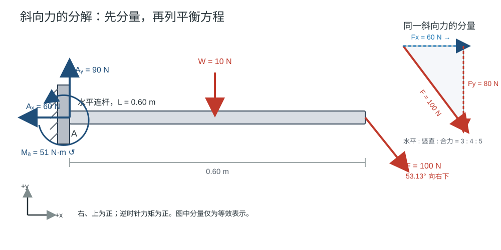

# 第 04 单元：力分解与斜向载荷

状态：**讲解、示例与练习已发布；等待学习者作答**（2026-11-17）。不要提前公开练习答案。

## 1. 学习目标与前置知识

承接第三课「多载荷平衡」。本课开始处理不再竖直或水平的力。学完应能：

1. 识别斜向力的角度是相对水平线还是竖直线测量。
2. 用直角三角形把一个斜向力分解为水平、竖直两个分量。
3. 根据力的实际指向给分量添加正负号。
4. 将力分量代入静力平衡方程，求出固定端反力和反力矩。
5. 判断某个分力是否产生力矩，而不是误以为所有分力都会产生力矩。

前置知识：正交的水平/竖直方向、固定端三个反力未知量、第三课的多载荷平衡。三角函数只补本课需要的部分，不要求先学完整三角学。

## 2. 为什么机器人结构中会出现斜向力？

机械臂夹爪抓住工件时，接触力不一定竖直向下；拉索、斜撑、倾斜连杆、斜面接触也会把力沿倾斜方向传递。

如果一股力既向左又向下，我们不能直接把它和纯水平力或纯竖直力相加。要先把它换成两个互相垂直的分量：

- 水平分量：描述这股力在水平方向上的效果。
- 竖直分量：描述这股力在竖直方向上的效果。

**分量不是多出来的两股真实载荷。** 它们是同一个斜向力的数学表示，两个分量合起来，效果与原来的斜向力完全相同。不要把原力和两个分量重复相加。

## 3. 先认识直角三角形：sin 和 cos 怎么用？

假设角度 θ 是从水平线量起：

- 斜边是原来的力 F；
- 邻边是水平分量 Fx；
- 对边是竖直分量 Fy 的大小。

因此：

`Fx = F cos θ`

`|Fy| = F sin θ`

记忆方法：

- **cos：角度旁边那条边**，本题就是水平分量。
- **sin：角度对面那条边**，本题就是竖直分量。

如果角度是从竖直线量起，水平与竖直分量对应的 sin/cos 就要交换。不要只背公式，先看角度画在哪一侧。

### 方向和正负号

本课程继续约定：向右为 +x，向上为 +y。

| 分量方向 | 符号 |
|---|---:|
| 向右 | +Fx |
| 向左 | −Fx |
| 向上 | +Fy |
| 向下 | −Fy |

例如，一股力朝右下方：水平分量为正，竖直分量为负。**sin 和 cos 只给分量大小；方向正负要根据箭头判断。**

### 用 3-4-5 三角形先算一次

如果一个 100 N 的斜向力形成 3-4-5 直角三角形：

- 水平边占斜边的 3/5，所以水平分量大小为 100 × 3/5 = 60 N；
- 竖直边占斜边的 4/5，所以竖直分量大小为 100 × 4/5 = 80 N。

这个角度约为 53.13°（从水平线量起），所以 cosθ = 0.6、sinθ = 0.8。这样可以先理解分量关系，不必一上来就死记小数。

## 4. 受力图：斜向力与它的分量

本图中的斜向外力为 100 N，作用在水平连杆末端，方向向右下方。它可以表示为向右 60 N、向下 80 N 两个分量。连杆自身重力 10 N 作用在中点。

蓝色箭头表示固定端反力；红色箭头表示外载。右侧的直角三角形展示分量关系。分量箭头只是同一斜向力的等效表示，不是额外载荷。

## 5. 完整例题：固定端支架受到斜向力

### 已知与模型

一根水平刚性连杆左端 A 固定，长度 L = 0.60 m，自身质量 1.0 kg，质量均匀。末端受到 100 N 的斜向力，方向为**水平线以下 53.13°、向右下方**。取 g = 10 m/s²。

假设：二维静力平衡；连杆足够刚；力作用在连杆中心线末端；忽略连接件、线缆自重、变形、振动与冲击。

### 第一步：先分解斜向力

3-4-5 比例给出：

- Fx = +100 × 3/5 = +60 N，向右；
- Fy = −100 × 4/5 = −80 N，向下。

这里负号很重要：竖直分量向下。

### 第二步：计算连杆自重

连杆重量 W = 1.0 × 10 = 10 N，向下。均匀连杆的重心在中点，距 A 为 0.30 m。

### 第三步：列水平方向平衡

`ΣFx = Ax + 60 = 0`

所以 Ax = −60 N，也就是固定端提供 60 N 向左的水平反力。

### 第四步：列竖直方向平衡

`ΣFy = Ay − 80 − 10 = 0`

所以 Ay = 90 N，方向向上。

### 第五步：绕 A 点取力矩

约定逆时针为正。末端的 80 N 向下分量使连杆顺时针转动；连杆自重也使它顺时针转动。

`ΣMA = MA − 80 × 0.60 − 10 × 0.30 = 0`

所以固定端反力矩为 51 N·m，逆时针。

**为什么 60 N 的水平分量没有出现在这道力矩方程中？** 因为它的作用线沿着水平连杆中心线，经过 A 点，垂直力臂为零。它仍然会影响水平反力 Ax。

注意：这不代表水平分力永远不会产生力矩。如果力的作用线与 A 点有垂直偏距，它同样可能产生力矩。判断时看的是“力的作用线到取矩点的垂直距离”，而不是只看力的名称。

## 6. 本课最容易犯的五个错误

1. **sin/cos 用反：** 先确认角度从水平还是竖直量起，再找邻边和对边。
2. **只算绝对值：** 斜向力向左、向右、向上、向下，分量的正负号不能省略。
3. **重复计算：** 原斜向力与它的两个分量不能同时放进同一个平衡方程。
4. **认为水平分力一定没有力矩：** 只有它的作用线经过取矩点时，力臂才为零。
5. **把力矩单位写成 N：** 力用 N，力矩用 N·m。

## 7. 基础练习：相机支架受到斜向外力

水平支架左端 A 固定，长度 0.50 m，自身质量 0.4 kg，质量均匀。末端受到 50 N 的力，方向为**水平线以下 30°、向右下方**。取 g = 10 m/s²。可使用 sin30° = 0.5、cos30° ≈ 0.866。

请回答：

1. 将 50 N 斜向力分解成 Fx、Fy，分别写出大小、正负号和方向。
2. 支架自重是多少？作用点在哪里？
3. 求固定端 Ax、Ay，注明方向。
4. 求固定端反力矩 MA，注明方向与 N·m 单位。
5. 写出 ΣFx = 0、ΣFy = 0、ΣMA = 0 三个平衡方程。

## 8. 工程应用：机械臂夹爪承受斜向接触力

一根水平机械臂连杆左端 A 固定，长度 0.70 m，自身质量 1.0 kg，质量均匀。末端夹爪与工件接触，工件对夹爪施加一个 80 N 的力，方向为**水平线以下 30°、向左下方**。取 g = 10 m/s²。

请回答：

1. 将 80 N 分解为水平和竖直分量，注明方向和正负号。
2. 求连杆自重及其重心位置。
3. 求 A 点的水平反力、竖直反力和反力矩。
4. 如果同一个 80 N 力的方向不变，但作用点从 0.70 m 移到 0.35 m，哪些反力会变化？反力矩变化多少？解释原因。

## 9. 本课结束后应具备的能力

能把一个斜向外力转成水平、竖直分量，正确添加符号，并与其他载荷一起写进平衡方程。后续的斜拉索、斜撑、斜面接触、夹爪摩擦和机械臂关节载荷都会用到这一能力。

**本课仍然是二维、静止、刚体模型。** 还没有分析铰支撑、滚动支撑、摩擦、材料应力或动态加速度；不要把本课反力结果直接当成实机选型或安全验收结论。

## 参考教学资源

本课沿用仓库已固定版本的 [mechanics-visuals](../resources/vendor/baratilab/skills/mechanics-visuals/SKILL.md) 与 [FBD 图示规范](../resources/vendor/baratilab/skills/mechanics-visuals/references/fbd_style.md)，以及 [worked-problem-generator](../resources/vendor/baratilab/skills/worked-problem-generator/SKILL.md) 的例题核算与练习设计流程。当前例题数值用附带 Python 标准库脚本复核；没有声称执行了 Pint 自动单位检查。
